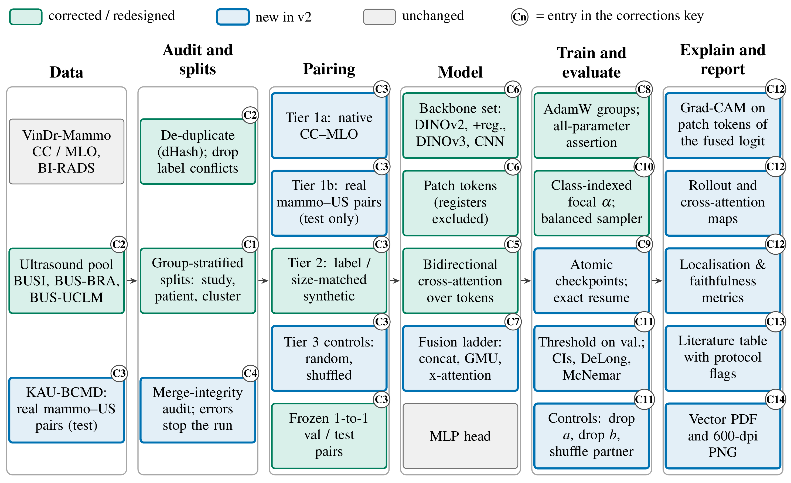
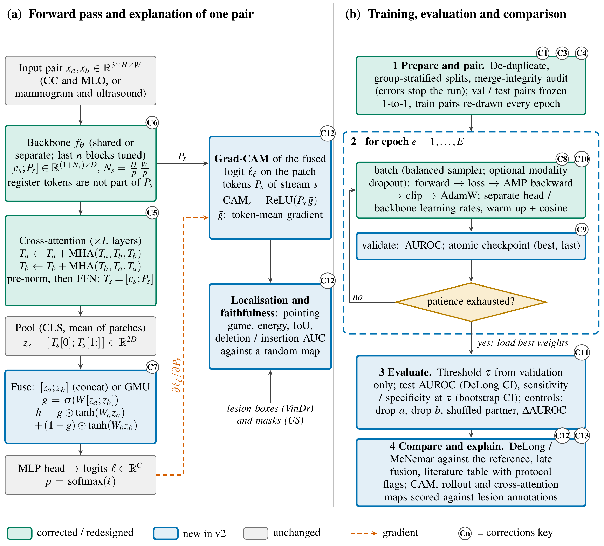

# MMIBC v2: explainable multimodal breast-cancer imaging

Code for **"MMIBC: An Explainable Multimodal Imaging Framework for Breast Cancer Diagnosis Using Mammography and Ultrasonography"**.
This branch (`revision/v2`) is a ground-up rebuild made in response to the reviews of the first submission. The old code is kept untouched in [`legacy/`](legacy/).

> **Status.** The pipeline, the audits and the test suite are complete and run end to end on synthetic data (`mmibc smoke`). **No results from the rebuilt pipeline on the real datasets exist yet**: the numbers in the rejected submission (e.g. 84 % accuracy) came from the old code, whose problems are listed below, and should not be quoted as results of this repository.



## Quick start (Google Colab)

Open [`notebooks/colab_quickstart.ipynb`](notebooks/colab_quickstart.ipynb) and run it top to bottom, or from a terminal:

```bash
git clone -b revision/v2 https://github.com/dev-tyta/MMIBC.git && cd MMIBC
pip install -e ".[download]"      # kagglehub + requests for the dataset downloads
mmibc smoke                       # whole pipeline on synthetic data, CPU, under a minute
mmibc download vindr_images vindr_annotations busi
mmibc prepare all -c mammo_us_synthetic
mmibc audit   -c mammo_us_synthetic          # prints every data check; trains nothing
mmibc run     -c vindr_multiview             # native CC<->MLO pairs: prepare -> train -> evaluate -> explain -> figures
mmibc run     -c mammo_us_synthetic --set task.pair_mode=label_matched
mmibc suite ladder                           # fusion ablation on identical frozen test pairs
mmibc figures --template lncs
```

Persistent files (processed images, splits, checkpoints, weights, figures) go to Google Drive under `MyDrive/MMIBC`; raw downloads are saved there too (`raw/`; set `paths.raw_on_drive=false` for Colab's temporary disk if your Drive is small). Everything is resumable: re-run a command after a disconnect.

## What was wrong, and what changed

Statements about v1 are limited to what was verified in the submitted code or in the submission text.

| | Component | Rejected submission (v1) | This work (v2) |
|---|---|---|---|
| C1 | Splits | sklearn train\_test\_split on files / images (not group-aware). | Group-stratified by study, patient and near-duplicate cluster; official VinDr test untouched; assert\_no\_leakage. |
| C2 | Ultrasound data | 'normal' mapped to benign (label 0); duplicate and conflicting-label copies kept. | Default binary\_no\_normal; dHash de-duplication, conflicts dropped; Doppler / caliper overlays inpainted; masks merged. |
| C3 | Pairing | Random pairing of mammogram and ultrasound images that share a label (as described in the submission). | Tiers: native CC-MLO; real mammogram-US (evaluation only); synthetic label-matched / size-conditioned; random and shuffled controls. Within-split; frozen 1-to-1 val / test pairs; train pairs re-drawn each epoch. |
| C4 | Merge audit | No integrity checks. | Schema, label mapping, cross-split duplicates, external-source isolation, class counts, file integrity, source-label confounding; errors stop the run. |
| C5 | Cross-attention | Attention over a length-1 sequence: softmax = 1, output = v\_proj(context), query ignored. | Bidirectional multi-head cross-attention over patch-token sequences (pre-norm, FFN); query-dependence assertion. |
| C6 | Backbone | DINOv2 only; CLS vector only. | Registry: DINOv2, DINOv2 with registers, DINOv3 (patch 16, 4 registers excluded from the grid), CNN baselines; dead mask\_token frozen. |
| C7 | Fusion | Single fusion variant. | Ladder: unimodal, early, concat, GMU, x-attn, x-attn + GMU; late fusion computed at evaluation. |
| C8 | Optimiser | Multimodal trainer optimised fusion\_classifier only. | AdamW groups (head / backbone lr, no decay on norms and tokens); every trainable parameter must be in the optimiser. |
| C9 | Checkpoints | Not resumable. | Atomic checkpoints; exact resume (RNG restored); config and frozen-weight fingerprints. |
| C10 | Loss / sampling | Focal alpha was one scalar multiplier (no class weighting). | Class-indexed alpha; balanced sampler; warning when both correct imbalance. |
| C11 | Evaluation | Point estimates on a 117-image test set; 95% CIs for the unimodal rows only; checkpoint chosen by lowest validation loss. | Threshold chosen on validation only; stratified bootstrap CIs; DeLong, exact McNemar, paired bootstrap; drop-a / drop-b / shuffled-partner controls. |
| C12 | Explanation | Qualitative Grad-CAM overlays on each stream; no quantitative localisation or faithfulness evaluation. | Grad-CAM on patch tokens through the fused logit; rollout; cross-attention maps; pointing, energy, IoU, deletion / insertion vs random. |
| C13 | Benchmarks | Four-row comparison with works on other datasets and modalities (some private); no protocol-matched baselines. | Literature table with protocol flags (no unread numbers); protocol-matched config; baselines on identical splits. |
| C14 | Figures | Raster PNG figures in the default plotting style (e.g. the Grad-CAM panel). | Vector PDF / 600-dpi PNG, embedded fonts, journal column widths, colour-blind-safe palette. |

The corrections are drawn in `paper/figures/` (TikZ, vector) and tested; see *Figures* below.

## Design in brief

* **Pairing is tiered, and says what it is.** 1a native CC<->MLO views of one breast (genuine correspondence); 1b real same-patient mammogram + ultrasound pairs (KAU-BCMD, evaluation only); 2 synthetic label-matched or size-conditioned pairs; 3 controls (random, shuffled partner). Pairs never cross a split, validation/test pairs are frozen 1-to-1, training partners are re-drawn every epoch. A model that scores the same on the controls is not using the pairing, and the evaluation reports exactly that (`drop_a`, `drop_b`, `shuffle_b`).
* **Cross-attention that attends.** Pre-norm multi-head cross-attention over *token sequences* in both directions. The legacy module attended over a length-1 sequence (softmax = 1), so its output ignored the query; a test pins this down.
* **Backbones.** `dinov2_base` is the default (verified model id, Apache-2.0, reproducible). The registry also holds DINOv2 small/large, DINOv2 with registers, DINOv3 (ViT-S/B/L/H+; gated on Hugging Face, custom licence, needs `HF_TOKEN`; only ViT-L/16 was checked against its model card) and torchvision CNNs. `mmibc suite backbones` decides on your data; do not assume the newest model is the best one.
* **Merge integrity.** Before anything trains: schema, uid/path collisions, label mapping, leakage and cross-split near-duplicates (dHash), external-source isolation, class counts, file integrity, source-label confounding, pair integrity. Errors stop the run (`audit.stop_on_error`).
* **Evaluation.** Threshold chosen on validation only; DeLong AUROC intervals, stratified bootstrap, exact McNemar, paired bootstrap; late fusion computed from the unimodal runs.
* **Explanations are measured, not just displayed.** Grad-CAM on patch tokens through the *fused* logit, attention rollout, cross-attention maps; pointing game, energy in lesion, IoU, deletion/insertion AUC, each against a random-map baseline, scored on VinDr boxes and ultrasound masks.
* **Literature comparison with protocol flags** (`benchmarks/literature.csv`). A published number is shown as comparable only if the run satisfies the protocol it was obtained under (labels, split). Papers that could not be read carry no numbers.

## Data

| key | what | status |
|---|---|---|
| `vindr_images`, `vindr_annotations` | VinDr-Mammo (PNG conversion, annotations) | Kaggle slugs from the legacy code |
| `busi` | BUSI | Kaggle mirror slug **unverified** |
| `bus_bra` | BUS-BRA ultrasound (Zenodo, CC BY 4.0) | URL download |
| `kau_bcmd` | KAU-BCMD, real mammogram + ultrasound pairs | Kaggle slug; layout unknown, inspect first |
| `bus_uclm` | BUS-UCLM ultrasound (lesion segmentation) | Kaggle slug from the page title; layout unknown, inspect first |
| `cmmd` | CMMD, **mammography** (biopsy-confirmed), not ultrasound | Kaggle slug from the page title; layout unknown, inspect first; no `prepare` step consumes it yet |
| `breast_lesions_usg` | BrEaST-Lesions-USG, intended external ultrasound test set | TCIA: images-and-masks zip **and** clinical spreadsheet (URLs supplied by the maintainer; layout and columns unverified, inspect first) |

`mmibc download` lists them, `mmibc download --all` fetches every one (continues past failures, prints a summary, skips what already arrived); `mmibc inspect <key>` shows what actually arrived. Sources that do not follow a class-folder layout need a `source_manifest.csv` (`uid, raw_path, class_name[, mask_paths, patient_id]`). The VinDr label is a BI-RADS *suspicion* grouping (`birads_4plus` or `birads_3plus`), not pathology. Known caveat for anyone using foundation models pre-trained on VinDr: a validation split carved from VinDr-train may overlap their pre-training data.

## Repository map

```
configs/        base.yaml, vindr_multiview, mammo_us_synthetic, protocol_petrini, smoke, suites/{ladder,backbones,pairing}
src/mmibc/
  data/         registry, download, preprocess, ultrasound, vindr, splits, pairing, merge_audit
  models/       backbones (registry), attention, fusion (ladder), factory
  training/     losses, optim, checkpoint (atomic, resumable), trainer
  evaluation/   metrics, stats (DeLong, McNemar, bootstrap), evaluate, compare
  xai/          ground_truth, explain, metrics, report
  benchmarks/   literature.csv, compare
  figures/      style, plots, make, tex (TikZ build), corrections (single source of the key)
  pipeline.py, suite.py, cli.py
paper/figures/  TikZ diagrams (fig_architecture, fig_algorithm), corrections table, pre-built PDF / SVG / 600-dpi PNG
tests/          every claim in the table above has a test
legacy/         the first-submission code, unchanged
```

## Figures for the paper

* Data plots (ROC with DeLong intervals, fusion ladder, controls, calibration, explanation summary, split composition, explanation overlays) come from `mmibc figures`: vector PDF + SVG + 600-dpi PNG, embedded fonts, colour-blind-safe palette, widths per venue (`--template lncs|ieee|elsevier|generic`).
* The architecture and algorithm diagrams are TikZ, drawn for a 12.2 cm text width (Springer LNCS / MICCAI). In the paper: `\input{figures/mmibc_tikz}` once in the preamble, then `\input{figures/fig_architecture}` inside a `figure`; for another width wrap it in `\resizebox{\linewidth}{!}{...}`. `tab_corrections.tex` is the table above. Rebuild with `mmibc figures --tex` (needs `texlive-latex-extra` and `poppler-utils`); the committed PDFs work without TeX.



## Tests

```bash
pip install -e ".[dev]" && pytest -q
```

CPU only, no downloads (OpenCV is optional: inpainting has a fallback, CLAHE needs it; tiny random backbones, synthetic images with planted defects to prove that the audits catch them).

## Citation

To be added after the revised paper is accepted. Please cite the datasets you use (VinDr-Mammo, BUSI, BUS-BRA, KAU-BCMD).
